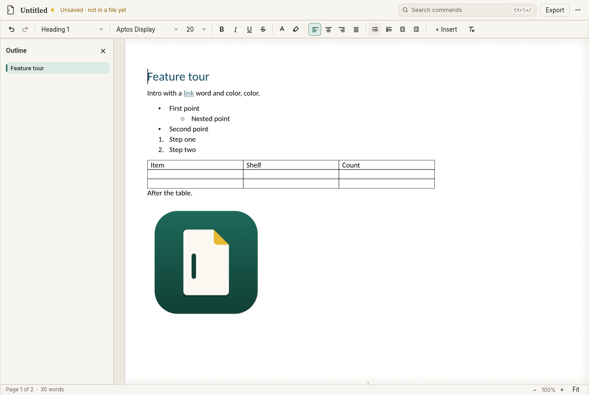

<p align="center"></p>

<p align="center"><b>Write the page you'll send.</b><br>
A local-first desktop word processor that edits real pages, keeps Word files intact,<br>and tells you before anything could be lost.</p>

<p align="center"></p>

Pagewright is **built on the [WordCraft](https://github.com/storytold/wordcraft) engine** (MIT OR
Apache-2.0), which provides the document model, editing commands, layout, file formats and PDF
writer. Pagewright adds a new interface, a product layer with file-safety rules, and its own brand.
It is an early release: see [what works](docs/feature-matrix.md) and [what doesn't](docs/known-gaps.md).

## Run it

You need [Rust](https://rustup.rs) 1.95 or newer; no system development libraries were needed to
build on Linux. **Verified on Linux only** (Ubuntu 24.04, x86-64). The code is cross-platform
(eframe/wgpu, arboard, rfd, craft-print all support macOS and Windows), but macOS and Windows builds
have not been compiled or run in this project yet.

```sh
cd pagewright
cargo run --release -p pagewright                       # the desktop app
cargo run --release -p pagewright -- ~/Letter.docx      # open a document
```

The first build compiles the engine and toolkit (about 5 minutes on 4 cores). The binary is
`target/release/pagewright` (Windows: `pagewright.exe`).

At run time Pagewright needs a graphics driver with Vulkan, Metal, DirectX 12 or OpenGL (on Linux,
Mesa is enough), and for printing the system spooler (CUPS on macOS and Linux). Without a desktop
file-dialog service (a bare X server or container) it uses its own file chooser; force either with
`PAGEWRIGHT_FILE_DIALOG=builtin|system`.

Command line, same pipeline and fidelity checks:

```sh
cargo run --release -p pagewright-cli -- convert report.docx report.pdf   # docx, odt, rtf, pdf, html, md, txt, tex
cargo run --release -p pagewright-cli -- check report.docx                # JSON: damage, mismatch, what a save would lose
cargo run --release -p pagewright-cli -- text report.docx
```

Settings and recovery copies live in `~/.config/pagewright` (Linux), `~/Library/Application
Support/Pagewright` (macOS) or `%APPDATA%\Pagewright` (Windows); `PAGEWRIGHT_PROFILE_DIR`
overrides it. `PAGEWRIGHT_NO_RECOVERY=1` turns recovery copies off.

## What's different

- **The page is the work surface.** No ribbon. A slim, contextual format bar (table tools appear in
  tables, header tools in headers), an outline that follows your position, and everything else in
  **command search** (`Ctrl+/`): type "landscape", "page numbers" or "word count".
- **You always know where your work is.** The title bar says where the document is saved and
  whether it has unsaved changes. Closing with unsaved work asks first.
- **Files stay intact.** When you open a Word file, Pagewright checks what an untouched save would
  lose. If anything, it says what, and replacing the original needs a decision whose default is
  *Save a copy*, which leaves the original byte-for-byte as it was. Damaged files and files whose
  content isn't the format their name claims are treated the same way.
- **Unsaved work survives a crash.** Local recovery copies are kept while you edit and offered on
  the next start; they never overwrite your file. Opt-in *Save automatically* writes to the file
  after you pause, only when no fidelity question is open.
- **Familiar keys.** Ctrl+B/I/U, Ctrl+Z/Y, Ctrl+Alt+1–3 headings, Ctrl+E centre, Ctrl+Enter page
  break, Ctrl+K link, F6 to the toolbar and Esc back (⌘ on macOS).

## How it's built

```
apps/pagewright        desktop shell: eframe/wgpu window, clipboard (arboard), dialogs (rfd), printing (craft-print)
apps/pagewright-cli    convert / check / text
crates/pagewright-ui   interface: page canvas, format bar, outline, command search, dialogs, theme, icons
crates/pagewright-core document lifecycle, file-format policy, fidelity guard, recovery wiring (no UI)
vendor/wordcraft       WordCraft engine at e6c5a70, one small documented patch
```

| Concern | Where |
|---|---|
| Document model | `vendor/wordcraft/crates/doc` (WordCraft) |
| Editing commands, undo, selection | `vendor/wordcraft/crates/engine` (WordCraft, 633 commands; Pagewright offers a curated subset) |
| Layout and pagination | `vendor/wordcraft/crates/layout` (WordCraft) |
| File formats | `vendor/wordcraft/crates/{docx,docbin,formats}` (WordCraft); format policy and the fidelity guard in `pagewright-core` |
| Rendering | `vendor/wordcraft/crates/{render,pdf}` (WordCraft); page textures, caret and selection in `pagewright-ui/src/canvas.rs` |
| Application UI | `crates/pagewright-ui` (Pagewright) |

Decisions: [why build on WordCraft](docs/decisions/0001-foundation.md). Behaviour:
[findings about Word](docs/research/word-behavior.md) and [specifications with their
tests](docs/specs/behavior.md). Brand: [BRAND.md](BRAND.md). Status: [STATUS.md](STATUS.md).
Packaging and release routes: [docs/deployment.md](docs/deployment.md).

## Test it

```sh
cargo test                                         # Pagewright: core, UI (incl. accessibility tree), apps
cargo test -p wordcraft-engine -p wordcraft-docx   # the vendored engine's own suites
python3 fixtures/generate.py                       # regenerate the synthetic fixture suite
python3 tools/roundtrip_check.py --cli target/release/pagewright-cli --out /tmp/rt
python3 tools/compare_pdf.py --cli target/release/pagewright-cli --out /tmp/pdf
python3 tools/gui_workflow.py --app target/release/pagewright --out /tmp/gui   # drives the real window (Linux, Xvfb, xdotool)
```

`tools/ooxml-validate` (built with `dotnet build -c Release -o bin` in that folder) validates DOCX
files with Microsoft's open-source Open XML SDK. Results of the latest run are in
[docs/test-results.md](docs/test-results.md).

## Licence

Pagewright's own code: MIT OR Apache-2.0 ([LICENSE-MIT](LICENSE-MIT), [LICENSE-APACHE](LICENSE-APACHE)). The vendored engine keeps its MIT OR Apache-2.0 licence
and notices. Everything else shipped is listed in [THIRD_PARTY_NOTICES.md](THIRD_PARTY_NOTICES.md).
Pagewright is independent and not affiliated with Microsoft or the ArtCraft Team. "Pagewright" is
a provisional name; no trademark clearance has been done.
